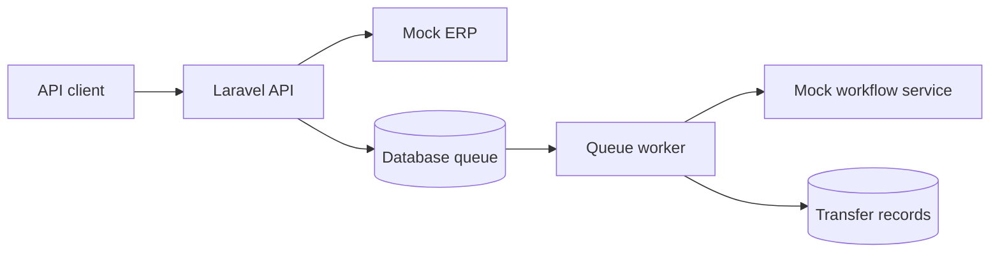

# Enterprise Integration API

A small Laravel backend demonstrating how to transfer orders from a fictional ERP to a workflow service using REST APIs, asynchronous jobs and persistent completion tracking. This is an independent portfolio project with synthetic data and local mock services.

## Architecture



The preview endpoint reads and validates source records without scheduling jobs. Dispatch re-reads the source, skips invalid and completed orders, and returns HTTP 202. One worker processes the integration queue. Each destination request uses a stable idempotency key; the mock destination persists that key and returns the existing identifier when a request is repeated. Successful transfers are also recorded locally. Failed jobs are retried up to three attempts, then recorded in `failed_jobs`.

## Stack

PHP 8.4 · Laravel 12 · SQLite · Laravel database queues · Docker Compose · PHPUnit · GitHub Actions

## Run locally

Requirements: Docker with Compose. No external account, real ERP, token or proprietary data is needed.

```bash
cp .env.example .env
docker compose up -d --build
```

On PowerShell use `Copy-Item .env.example .env` instead. This API-only demo does not use sessions or encryption; if needed, generate an application key with `docker compose exec api php artisan key:generate --show` and set `APP_KEY` in `.env`, then recreate the services.

The API listens on `http://localhost:8000`. The mock service is reachable only inside the Compose network. The API is intentionally unauthenticated and bound to loopback; do not publish it on the internet.

## Example requests

```bash
curl -X POST http://localhost:8000/api/integrations/orders/preview \
  -H 'Content-Type: application/json' -H 'Accept: application/json' \
  -d '{"since":"2026-01-01"}'
```

Expected: three sample orders, two ready and one warning (missing email).

```bash
curl -X POST http://localhost:8000/api/integrations/orders/dispatch \
  -H 'Content-Type: application/json' -H 'Accept: application/json' \
  -d '{"since":"2026-01-01"}'
```

Expected: HTTP 202 and `{"queued":2,"invalid":1}`. After the worker finishes:

```bash
curl http://localhost:8000/api/integrations/orders/ORD-1001
docker compose logs worker
```

The status endpoint returns the completed record or 404 if no completion has been recorded. Dispatch again after completion: `queued` should be zero. If dispatch is repeated while work is pending, redundant jobs may enter the queue, but completed records and the destination idempotency contract prevent duplicate work items in the demo.

## Tests

```bash
docker compose run --rm api composer test
```

Feature tests cover preview isolation, validation, dispatch, successful transfer deduplication and failure handling. The GitHub Actions workflow runs the tests on pushes and pull requests.

## Design notes and limitations

- The destination must support durable idempotency keys for safe retries after a lost response. Without that guarantee, retries can create duplicates. The mock implements this contract using a file lock and a persistent volume; it is not a production database.
- The order identifier represents an immutable order in this demo. Updates and versioned events would require a different key strategy.
- Queue persistence and completed transfers use a shared SQLite volume for a small local demonstration, not for distributed high-throughput workloads.
- A 202 response confirms scheduling, not delivery. The status endpoint reports completed transfers only. Failed jobs can be inspected with `docker compose exec worker php artisan queue:failed`.
- No authentication, rate limiting, external deployment or production observability is included. These are deliberate boundaries of the demo.
- Stop with `docker compose down`; use `docker compose down -v` only to erase all demo state.

## Project layout

`app/Http` — input validation and HTTP endpoints  
`app/Services` — source validation and destination integration  
`app/Jobs` — asynchronous work  
`mock/` — fictional source and destination endpoints  
`tests/` — feature tests

## License

MIT — see [LICENSE](LICENSE).
